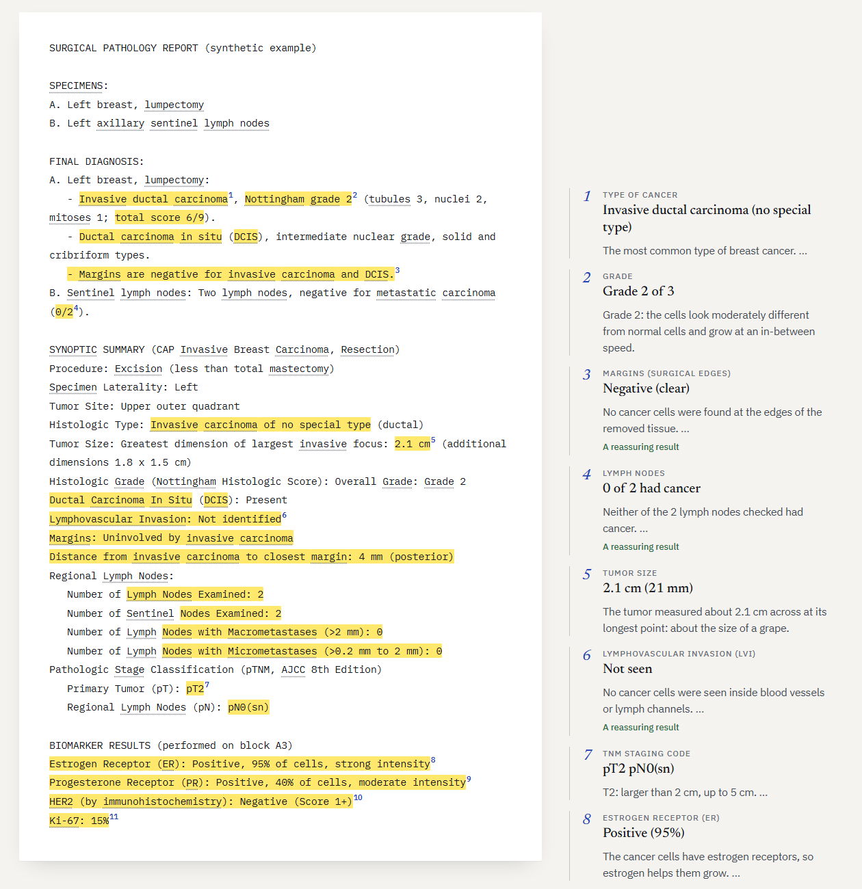
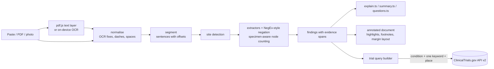

# PathLight

**Your pathology report, read alongside you.**

PathLight reads a cancer pathology report (pasted text, a PDF from a patient portal, or a phone photo of the paper copy) and turns it into an annotated document. Every finding is highlighted in the report itself and numbered like a footnote, and a plain-language note sits in the margin beside it. A short summary, a tailored list of questions for the care team, and an optional live search of recruiting clinical trials complete it.

Everything runs in the browser tab. There is no PathLight server, and the browser's security policy blocks the page from sending the report anywhere.

Built for the **2026 International CodeTheCure Hackathon**, category **Detection & Diagnosis** (medical report visualization).

> PathLight is an educational tool, not a medical device. It does not diagnose, stage or give medical advice. All bundled reports are synthetic.



## Why

- Since the 21st Century Cures Act information-blocking rules (2021), results, including pathology reports, are released to patient portals immediately, often before the doctor has called.
- In a 2023 survey of 8,139 portal users (Steitz et al., *JAMA Network Open* 2023;6(3):e233572), 95.7% wanted immediate access. But 16.5% of those with abnormal results felt more worried reading them before talking to a clinician, and 39.9% searched the internet for answers.
- Pathology reports are written for pathologists: `pT2 pN0(sn)`, `HER2 (IHC): Negative (Score 1+)`, `LVI: not identified`.

## What it does

| | |
|---|---|
| **Reads any input** | Paste text; upload a PDF (text layer read with pdf.js); scanned PDFs and **phone photos read with on-device OCR** (tesseract.js WebAssembly, served from this site) |
| **Annotates the report** | Findings are highlighted in the original text and numbered. Margin notes on desktop sit level with their line; on phones they become footnotes. Click either side to jump to the other. Dotted words open a definition. |
| **Writes a summary** | A plain-English opening paragraph generated from the findings by fixed rules (no AI), with each phrase linked to its note |
| **Finds** | Cancer type and in-situ component, grade, size, Breslow depth, Gleason and Grade Group, Ki-67, TNM (y/p/c prefixes, (sn)/(i+) suffixes), margins and closest distance, lymph nodes (per specimen), LVI, perineural invasion, extraprostatic extension, seminal vesicle and visceral pleural invasion, ulceration, tumor deposits, extranodal extension, ER/PR (ASCO/CAP "low positive"), HER2 (ASCO/CAP 2018 algorithm with HER2-low and ultralow), mismatch repair / MSI, and benign "no malignancy" results |
| **Explains** | AJCC 8th edition T and N wording per organ, guideline context (ASCO/CAP, ISUP, IKWG Ki-67, SSO-ASTRO margins), to-scale size drawings, node grids, receptor bars, bowel-wall depth diagram |
| **Asks** | Up to 9 questions chosen from the findings (HER2-low, dMMR and Lynch syndrome, fewer than 12 colon nodes, sentinel biopsy for melanoma 0.8 mm or thicker, and others). Copy or print them. |
| **Connects** | **Live clinical-trial search** through the public ClinicalTrials.gov API v2 (free, no key). It sends only a condition, at most one marker keyword and an optional place, and shows the exact query before anything is sent. |
| **Is humane** | A "Before you read" check-in, calm wording ("worth asking about", never alarms), read-aloud, larger text, keyboard and screen-reader support, dark mode, print as a footnoted document, support hotlines |

## Privacy, enforced by the browser

The production build ships this Content-Security-Policy (`src/policy.ts`, shown verbatim on the landing page):

```
default-src 'self'; script-src 'self' 'wasm-unsafe-eval'; style-src 'self' 'unsafe-inline'; font-src 'self';
img-src 'self' data: blob:; worker-src 'self' blob:; connect-src 'self' https://clinicaltrials.gov;
object-src 'none'; base-uri 'self'; form-action 'none'
```

- `connect-src` allows exactly one outside address: the public trial registry, used only when the person presses Search, with only the words they can see.
- Fonts, the PDF engine, the OCR engine and its English model are all bundled. No CDNs, analytics, cookies or storage. State lives in memory and is erased by "Start over" or by closing the tab.
- Trial requests are sent with `credentials: 'omit'` and no referrer.

## Accuracy

### Real-world: 1,548 held-out pathology reports

PathLight was evaluated on **TCGA-Reports**: 9,523 real, de-identified, OCR'd pathology reports from The Cancer Genome Atlas (Kefeli & Tatonetti, *Patterns* 2024; doi:10.17632/hyg5xkznpx.1). For each report, its output was compared with the curated TCGA clinical record for the same patient, fetched from the public cBioPortal API (breast, colorectal, lung, prostate and melanoma studies).

Patients were split 50/50 by a hash of their ID. **Only the development half was ever inspected** to find and fix errors; the test half below is held out.

| Field (test half) | Labeled | Answered | Agreement when answered | Coverage |
|---|---:|---:|---:|---:|
| Estrogen receptor | 478 | 242 | 97.5% | 50.6% |
| Progesterone receptor | 477 | 240 | 92.5% | 50.3% |
| HER2 status | 446 | 182 | 76.9% | 40.8% |
| Pathologic T | 1,329 | 856 | 96.8% | 64.4% |
| Pathologic N | 1,329 | 789 | 98.2% | 59.4% |
| Lymph nodes positive | 892 | 546 | 89.0% | 61.2% |
| Lymph nodes examined | 913 | 605 | 72.1% | 66.3% |
| Gleason score | 219 | 143 | 90.2% | 65.3% |
| Breslow depth | 41 | 24 | 91.7% | 58.5% |
| Ulceration | 40 | 28 | 100% | 70.0% |
| Organ (site) | 1,548 | 1,548 | 98.2% | 100% |
| **All values** | **8,150** | **5,489** | **92.6%** | **67.3%** |

The first version of the engine scored 89.5% at 62.5% coverage on the same held-out half. The errors found on the development half (OCR misreading `pN0` as `pNO`, form text like `(0-3+,n/a)`, results written before the marker name, a total restated after its parts, identical sentinel-node specimens, counts spelled out past twenty) were fixed, and each one is now a regression test.

**How to read these numbers.** "Coverage" is low on purpose. Many TCGA reports simply do not contain the value (HER2 is often reported separately), and PathLight stays silent instead of guessing. Some disagreements are label noise: TCGA's curated record sometimes draws on documents other than the report, which shows clearly in lymph-node counts that include other specimens. The real-world data is not part of the repository. Fetch it with `bash scripts/fetch-tcga.sh`, then run `npm run eval:tcga`.

### Synthetic gold and stress sets

| Set | Reports | Values | Result |
|---|---:|---:|---|
| Gold set (CAP-template style) | 20 | 206 | 100% precision and recall |
| Stress set, first run | 12 | 100 | 94.4% F1, then 100% after fixes |

`npm run eval` and `npm run eval -- stress`. Both sets were written by the author, which is why the TCGA results above matter more.

## Architecture



- `src/engine/`: the pure TypeScript engine (no DOM, no network). `analyze(text)` returns findings, each with character-offset evidence spans.
- `src/components/AnnotatedDocument.tsx`: the report with highlights and footnote numbers, plus a margin layout that keeps each note level with its first highlight and pushes notes down when they would overlap.
- `src/trials.ts`, `src/ocr.ts`, `src/pdf.ts`, `src/policy.ts`: connectors and the security policy.
- `scripts/eval.ts`, `scripts/eval-tcga.ts`: the evaluations. `tests/`: 118 Vitest tests.

### Why rules instead of a large language model?

1. **Checkable.** Every note points to the words it came from, and the rules encode published guidelines. A fluent but wrong explanation of a cancer report is dangerous, and a patient cannot tell.
2. **Private.** A cloud model means sending health records to a third party; PathLight sends nothing.
3. **Free.** No API key and no per-use cost, so it can stay free.

## Design

The design avoids generic "AI app" defaults (purple gradients, the Inter font, centered heroes, rows of rounded cards with icons). Its choices come from the product itself:

- **The report is the interface.** The patient's own document is the main surface, marked the way a careful reader marks paper: a highlighter stroke, a footnote number and a note in blue "pen" in the margin.
- **Type:** Newsreader (an editorial serif) for reading, IBM Plex Sans for the interface, and IBM Plex Mono for the report, because reports look typed. All fonts are self-hosted.
- **Color:** ink on paper, highlighter yellow, annotation blue, and one restrained vermilion for "worth asking about". There is no red, and no alarm.

## Getting started

Requirements: Node.js 18 or newer.

```bash
npm install
npm run dev        # http://localhost:5173 (copies the OCR engine into public/ocr first)
npm test           # 118 unit tests
npm run build      # production build in dist/, with the security policy
npm run preview    # serve the production build at http://localhost:4173
```

Demo links open a bundled synthetic report directly: `/#example=breast-lumpectomy`, `/#example=colon-resection`, `/#example=prostate-biopsy`, `/#example=lung-lobectomy`, `/#example=melanoma-excision`.

### Deploy (GitHub Pages)

1. Push this folder to a public GitHub repository.
2. In the repository, go to **Settings → Pages → Build and deployment → Source** and choose **GitHub Actions**.
3. The workflow in `.github/workflows/deploy.yml` runs the tests and the synthetic evaluation, builds, and publishes the site.

## Limitations

- English-language reports only. OCR quality depends on the photo; PathLight shows the recognized text so it can be corrected before reading.
- No overall stage group is calculated, on purpose: AJCC prognostic staging needs information a pathology report does not contain.
- It is not a medical device and has not been clinically validated. Real-world agreement is measured against curated research records, not a pathologist's review.

## Roadmap

1. Review of explanations by a pathologist, and a usability study with patients and caregivers measuring comprehension and anxiety.
2. Spanish and other languages (all patient-facing text is in `explain.ts`, `summary.ts` and `questions.ts`).
3. More organs (kidney, bladder, thyroid, endometrium) and hematology reports.
4. An installable offline app (PWA).

## Credits and sources

TCGA-Reports (Kefeli J, Tatonetti N. *Patterns* 2024) · The Cancer Genome Atlas and cBioPortal · ClinicalTrials.gov (U.S. National Library of Medicine) · tesseract.js · pdf.js · AJCC Cancer Staging Manual 8th ed. · ASCO/CAP HER2 (2018, 2023) and ER/PR (2020) guidelines · ISUP 2014 Grade Groups · International Ki67 in Breast Cancer Working Group (2021) · NCI Dictionary of Cancer Terms.

## License

MIT. See [LICENSE](LICENSE).
